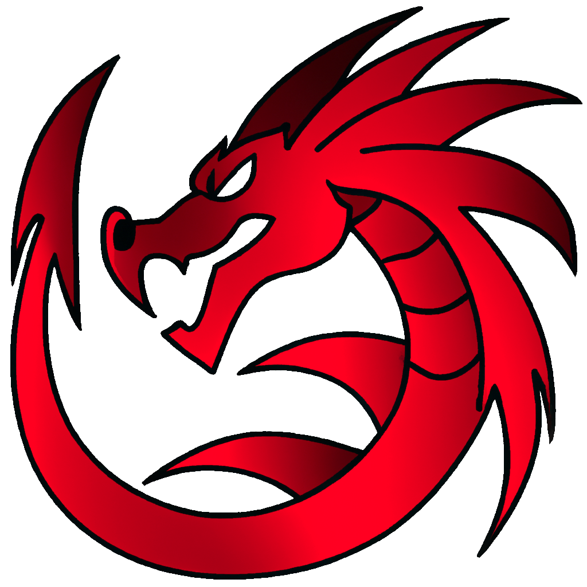
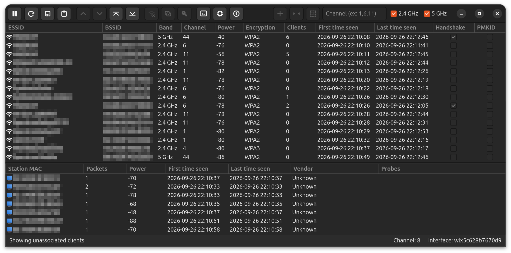
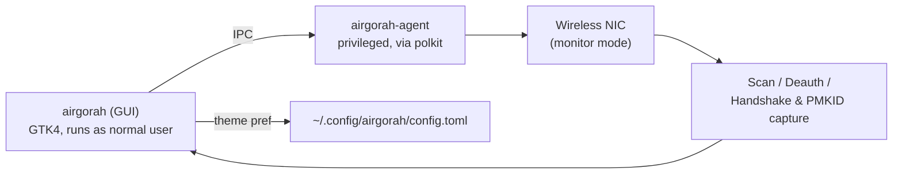

<div align="center">



# 🛰️ Airgorah-RT

### WiFi Security Auditing Tool — Red Team Fork of Airgorah

**Maintained by [Syed Muhammad Tayyab](https://github.com/Syed-Muhammad-Tayyab)**
*A fork of [Airgorah](https://github.com/martin-olivier/airgorah) by **Martin Olivier***

[](https://crates.io/crates/airgorah)
[](LICENSE)
[](https://www.rust-lang.org/)
[](https://www.gtk.org/)
[](#requirements)

[Why This Fork](#-why-this-fork) •
[Features](#-features) •
[Screenshots](#-screenshots) •
[Getting Started](#-getting-started) •
[Packaging](#-packaging) •
[Roadmap](#-roadmap) •
[FAQ](#-faq) •
[Credits](#-credits--attribution)

</div>

---

> [!IMPORTANT]
> **This is a fork, not an original project.** The overwhelming majority of the
> design, architecture, and code here — scanning, deauthentication attacks,
> handshake/PMKID capture, password cracking, and the privileged-agent model —
> is the work of **Martin Olivier**, released under the MIT License.
> See [`NOTICE.md`](NOTICE.md) for the full attribution and a precise list of
> what this fork adds. Please star and credit the
> [**upstream repository**](https://github.com/martin-olivier/airgorah) too.

## ⚠️ Legal

Airgorah-RT is designed to be used for testing and discovering flaws in
networks **you own or are explicitly authorized to test**. Performing
attacks on WiFi networks you do not own or have authorization for is
illegal in almost all jurisdictions. Neither the upstream author nor this
fork's maintainer is responsible for misuse of this software.

## 🧭 Why This Fork

This fork started while studying Airgorah's codebase as part of an IT &
Cybersecurity internship on a Red Team sub-team. It keeps 100% of the
upstream functionality and adds a couple of practical improvements:

| Area | What's new in Airgorah-RT |
|---|---|
| 🎨 UI/UX | A real **Appearance setting** — System / Light / Dark theme, persisted and applied live (not in upstream) |
| 📦 Packaging | A **Flatpak manifest** and a **Docker-free native build script**, alongside the original Docker/`fpm` pipeline |
| 📝 Docs | This README and [`NOTICE.md`](NOTICE.md), documenting the fork's scope and giving full upstream credit |

Everything else — scanning, deauth, handshake/PMKID capture, cracking,
vendor lookups, the privileged agent — is unchanged from upstream Airgorah.

## ✨ Features

<details open>
<summary><strong>Inherited from Airgorah (upstream)</strong></summary>

- 📡 Capture nearby WiFi traffic and discover access points
- 👥 Discover clients connected to each access point
- 💥 Perform deauthentication attacks against a target AP/client
- 🤝 Capture WPA/WPA2 handshakes and PMKIDs
- 🔓 Crack captured handshakes/PMKIDs via bruteforce or wordlist
- 🪪 MAC address spoofing (random / default / specific)
- 🔐 Privileged operations isolated into a small `airgorah-agent`, launched via `polkit`

</details>

<details open>
<summary><strong>Added in Airgorah-RT</strong></summary>

- 🌗 **System / Light / Dark** appearance setting in **Settings → Appearance**, saved to config and applied without restarting
- 📦 **Flatpak packaging** (`packaging/flatpak/com.syed.airgorahrt.yml`)
- 🛠️ **`scripts/build-native.sh`** — build + package locally without Docker

</details>

## 🖼️ Screenshots



*(Base interface shown is upstream Airgorah's; the Appearance setting added
in this fork lives in the Settings window pictured above.)*

## 🧱 Tech Stack

| Component | Technology |
|---|---|
| Language |  |
| GUI toolkit |  |
| Privilege separation | `polkit` + a dedicated `airgorah-agent` binary |
| Packet handling | Raw sockets, `libwifi`, `radiotap` (upstream `crates/common`) |
| Config | TOML (`~/.config/airgorah/config.toml`) |
| Packaging | Docker + `fpm` (upstream), **Flatpak** and **native script** (this fork) |

## 📂 Project Structure

```text
Airgorah-RT/
├── 📦 crates/
│   ├── 🖥️ gui/              # GTK4 front-end + GUI-side backend
│   │   ├── src/frontend/     # Windows, widgets, event wiring
│   │   │   └── interfaces/settings.rs   # 🌗 Appearance controls (this fork)
│   │   ├── src/backend/
│   │   │   └── settings.rs   # 🌗 Theme load/save/apply (this fork)
│   │   └── icons/
│   ├── 🤖 agent/             # Privileged agent (scan, deauth, capture)
│   └── 🔗 common/            # Shared types + IPC protocol
│       └── src/types.rs      # 🌗 `Settings.theme` field (this fork)
├── 📦 packaging/
│   └── flatpak/               # 🆕 Flatpak manifest + desktop/metainfo (this fork)
├── 🛠️ scripts/
│   └── build-native.sh        # 🆕 Docker-free build/package script (this fork)
├── 🐳 Dockerfile              # Upstream Docker-based build/package pipeline
├── 📄 NOTICE.md               # 🆕 Full upstream attribution (this fork)
└── 📄 README.md               # You are here
```

## 🧩 How It Works



## 🚀 Getting Started

### Requirements

- Linux (X11 or Wayland)
- A wireless network card supporting **monitor mode** and **packet injection**
- `polkit` (for the privileged agent)

### Build from source

```bash
git clone https://github.com/Syed-Muhammad-Tayyab/Airgorah-RT.git
cd Airgorah-RT
cargo build --release
./target/release/airgorah
```

### Configure the theme

Open **Settings → Appearance** and pick **System**, **Light**, or **Dark**.
The choice is saved to `~/.config/airgorah/config.toml` and reapplied on
next launch.

## 📦 Packaging

| Method | Command | Notes |
|---|---|---|
| Docker + `fpm` (upstream) | `docker build . -t airgorah_builder && docker run --rm -v $PWD:/workspace airgorah_builder` | Produces `.deb`, `.rpm`, `.pkg.tar.zst` |
| **Native script (this fork)** | `./scripts/build-native.sh deb` (or `rpm` / `pacman`) | Same artifacts, no Docker required |
| **Flatpak (this fork)** | `flatpak-builder build-dir packaging/flatpak/com.syed.airgorahrt.yml --install --user` | See manifest for offline-build notes |

## 🗺️ Roadmap

- [x] Appearance (System/Light/Dark) setting
- [x] Flatpak manifest
- [x] Docker-free native build script
- [ ] Propose Appearance setting upstream as a PR
- [ ] AppImage packaging
- [ ] CSV/JSON scan export

## ❓ FAQ

<details>
<summary>Is this an original project?</summary>

No — it's a fork of <a href="https://github.com/martin-olivier/airgorah">Airgorah</a> by Martin Olivier. See <a href="NOTICE.md">NOTICE.md</a> for exactly what this fork changes versus upstream.

</details>

<details>
<summary>Why fork instead of contributing upstream?</summary>

This started as a hands-on way to study the codebase during a Red Team internship. The Appearance setting may still be proposed upstream as a PR.

</details>

<details>
<summary>Does this work on Windows/macOS?</summary>

No, same as upstream — Linux only, due to raw-socket/monitor-mode requirements.

</details>

## 🤝 Contributing

Issues and PRs are welcome on this fork for the fork-specific additions
(Appearance setting, packaging). For anything touching the core
scanning/attack/capture logic, please consider contributing directly to
[upstream Airgorah](https://github.com/martin-olivier/airgorah) instead.

## 📜 License

Released under the [MIT License](LICENSE), unchanged from upstream.
Copyright retained for Martin Olivier as original author — see
[`NOTICE.md`](NOTICE.md) for details on this fork's additions.

## 🙌 Credits & Attribution

- **[Martin Olivier](https://github.com/martin-olivier)** — original author of [Airgorah](https://github.com/martin-olivier/airgorah). All core functionality in this fork is his work.
- **Syed Muhammad Tayyab** — maintainer of the Airgorah-RT fork (Appearance setting, Flatpak/native packaging, this documentation).

---

<div align="center">

**Fork maintained by Syed Muhammad Tayyab** · Based on **Airgorah** by Martin Olivier

</div>
